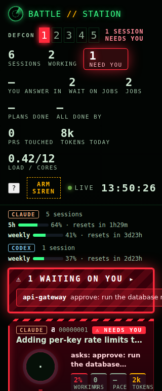
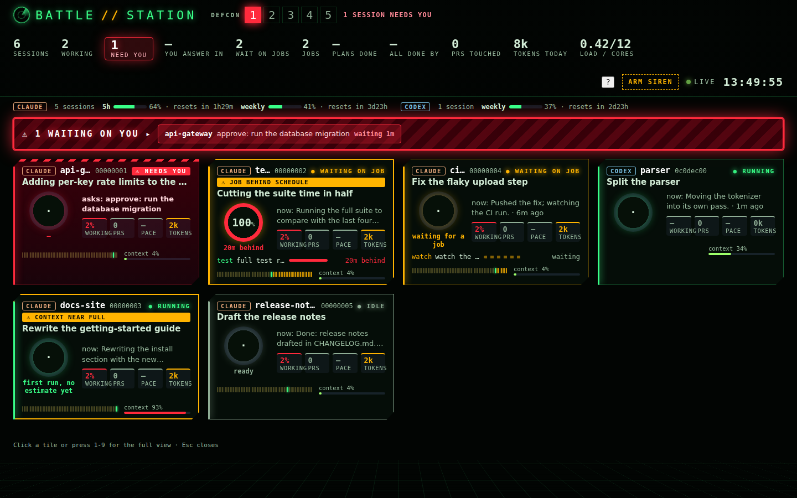

# Board layout preview

Synthetic `--demo` data at commit `dde110d`, captured from Chromium with the
page acknowledged (`/?ack`). These images show the revised mobile header and
tile layout alongside desktop. No real session content is present.

| 320 px phone | 1440 px desktop |
|---|---|
|  |  |

The phone view has no clipped brand or horizontal tile overflow. The desktop
view retains the four-column grid. The reduced-motion CSS contract is covered
by `tests/test_board_layout.py`.
